<div align="center">

# 🔬 SciFact Tiered Neural Search

### Dual-Tiered Biomedical Claim Verification & Neural Information Retrieval via Matryoshka Representation Learning (MRL), Two-Stage Dense Reranking & Hallucination-Filtered HyDE

[](https://www.python.org/)
[](https://pytorch.org/)
[](https://github.com/facebookresearch/faiss)
[](https://huggingface.co/NovaSearch)
[](https://streamlit.io/)
[](https://github.com/beir-cellar/beir)
[](#3-three-phase-architectural-evolution)

<p align="center">
  <em>An end-to-end neural information retrieval engine engineered for zero-shot scientific claim verification over the <strong>BEIR SciFact</strong> biomedical corpus (5,183 peer-reviewed abstracts, 300 evaluation claims). Combines a sub-30ms <strong>Fast Tier</strong> (1-Stage 256d Matryoshka FAISS) with a high-precision <strong>Pro Tier</strong> (2-Stage 256d &rarr; 1536d reranking + <code>Qwen3-8B</code> Hypothetical Document Embeddings + <code>GOLFer</code> lexical grounding), reaching <strong>0.8063 nDCG@10</strong> and <strong>0.9300 Recall@10</strong>.</em>
</p>

---

[**Live Walkthrough**](#-1-interactive-demo--system-walkthrough) &bull;
[**Key Benchmarks**](#-2-executive-summary--benchmark-highlights) &bull;
[**Architectural Evolution**](#-3-three-phase-architectural-evolution) &bull;
[**Mathematical Formulation**](#-4-mathematical-formulation--algorithmic-design) &bull;
[**Ablation Studies**](#-5-comprehensive-ablation-studies--experimental-results) &bull;
[**Quickstart**](#-6-quickstart--reproducibility)

</div>

---

## 🎥 1. Interactive Demo & System Walkthrough

<div align="center">
  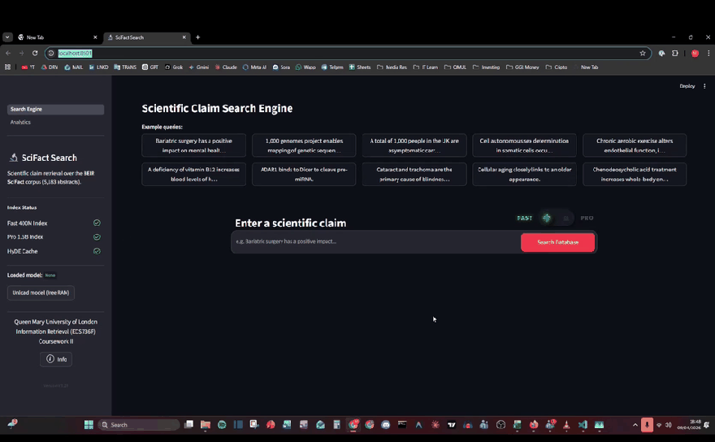
  <p><em><strong>Figure 1:</strong> End-to-end interactive workflow: switching between <strong>Fast Tier</strong> (1-Stage 256d MRL, ~29ms) and <strong>Pro Tier</strong> (2-Stage 256d &rarr; 1536d reranking with <code>Qwen3-8B</code> HyDE + <code>GOLFer</code> verification), inspecting ground-truth <code>qrels</code> badges, and reading side-by-side biomedical abstracts in the split-screen viewer.</em></p>
</div>

<div align="center">
  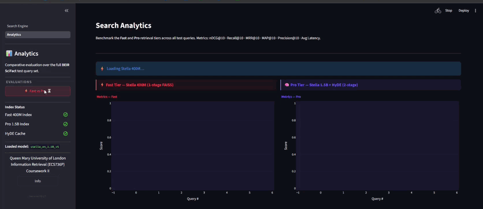
  <p><em><strong>Figure 2:</strong> Built-in <strong>Analytics &amp; Evaluation Suite</strong> running live head-to-head evaluation across all 300 BEIR SciFact test queries, streaming rolling progress bars and rendering comparative <code>nDCG@10</code>, <code>Recall@10</code>, <code>MRR@10</code>, <code>MAP@10</code>, <code>Precision@10</code>, and latency distributions.</em></p>
</div>

---

## 📊 2. Executive Summary & Benchmark Highlights

Scientific claim verification requires bridging a severe **lexical-semantic gap**: a concise user claim (*e.g., "0-dimensional biomaterials show inductive properties"*) rarely shares exact surface tokens with dense clinical abstracts reporting empirical outcomes. Standard lexical retrievers (`BM25`) fail on domain-specific terminology shifts, while naive LLM query expansion (`HyDE`) frequently hallucinates ungrounded biomedical entities that pull dense embeddings away from the true evidence (**semantic drift**).

We designed and evaluated a **Dual-Tiered Neural Retrieval Architecture** on the official [BEIR SciFact](https://huggingface.co/datasets/BeIR/scifact) benchmark (`5,183` corpus documents, `300` test claims):

| Retrieval System / Configuration | Architecture & Representation | nDCG@10 | Recall@10 | MRR@10 | MAP@10 | Precision@10 | End-to-End Latency | Index Lookup |
| :--- | :--- | :---: | :---: | :---: | :---: | :---: | :---: | :---: |
| **BM25 (Lexical Baseline)** | Sparse Bag-of-Words (`Lucene`) | `0.6650` | `0.8160` | `0.6280` | `0.6190` | `0.0910` | `~18.0 ms` | `~4.0 ms` |
| **Phase 2: Stella-1.5B + CSR ($k=32$)** | Top-$K$ Sparse Autoencoder (`6144d`) | `0.5210` | `0.6840` | `0.4890` | `0.4720` | `0.0740` | `~45.0 ms` | `~12.0 ms` |
| **Phase 2: LACONIC-8B (Sparse MLM)** | Bottleneck Masked LM (`32,000d` top-128) | `0.6487` | `0.8199` | `0.6110` | `0.6012` | `0.0890` | `~804.0 ms` | `~14.2 ms` |
| **Phase 2: LACONIC-8B + Naive HyDE** | Unfiltered LLM Abstract ($\alpha=0.50$) | `0.5819` | `0.7859` | `0.5420` | `0.5310` | `0.0820` | `~820.0 ms` | `~14.8 ms` |
| **⚡ Fast Tier (Production)** | **`Stella-400M` 1-Stage (`256d` MRL FAISS)** | **`0.7522`** | **`0.8849`** | **`0.7192`** | **`0.7094`** | **`0.1000`** | **`~29.2 ms`**¹ | **`2.62 ms`** |
| **Intermediate 2-Stage Ablation** | `Stella-400M` 2-Stage (`256d` &rarr; `1024d`) | `0.7738` | `0.9110` | `0.7381` | `0.7251` | `0.1030` | `~37.2 ms`¹ | `2.73 ms` |
| **🔬 Pro Tier (No-HyDE Ablation)** | `Stella-1.5B` 2-Stage (`256d` &rarr; `1536d`) | `0.8045` | `0.9283` | `0.7724` | `0.7604` | `0.1030` | `~29.0 ms`² / `106.7 ms`¹ | `2.68 ms` |
| **🏆 Pro Tier (Full Production)** | **`Stella-1.5B` 2-Stage (`256d` &rarr; `1536d`) + `Qwen3-8B` HyDE + `GOLFer` ($\alpha=0.7$)** | **`0.8063`** | **`0.9300`** | **`0.7721`** | **`0.7763`** | **`0.1053`** | **`~51.9 ms`**² / **`108.6 ms`**¹ | **`4.98 ms`** |

> **Hardware Notes:** ¹ Benchmarked on NVIDIA RTX 3060 Laptop GPU (6 GB VRAM). ² Benchmarked on NVIDIA RTX 3080 GPU (10 GB VRAM). Pre-computed `Qwen3-8B` + `GOLFer` abstracts are cached for the 300 BEIR SciFact queries; unseen user queries invoke live `Qwen3-8B` generation + `GOLFer` lexical filtering on demand (`~4.5s` one-off LLM synthesis).

### Key Engineering Contributions

1. **75% Index Memory Compression via Matryoshka Representation Learning (MRL):** Truncating `NovaSearch/stella_en_400M_v5` (`1024d` &rarr; `256d`) and `stella_en_1.5B_v5` (`1536d` &rarr; `256d`) with L2 re-normalization shrinks the Stage-1 FAISS `IndexFlatIP` footprint to **5.18 MB** (`2.62 ms` index lookup) while preserving dense semantic alignment.
2. **Two-Stage Coarse-to-Fine Reranking (`256d` &rarr; `1536d`):** Stage 1 retrieves the top $K=50$ candidates from the `256d` FAISS index; Stage 2 computes exact dot-product similarity against full `1536d` in-memory embeddings (`mrl_cache.pkl`), lifting `nDCG@10` from **`0.7522` &rarr; `0.8045`** (+5.23 points).
3. **Hallucination-Resistant Query Expansion (`Qwen3-8B` HyDE + `GOLFer` + $\alpha$-Interpolation):** Rather than trusting raw LLM-generated hypothetical abstracts (which caused a `-0.0668 nDCG@10` collapse under naive 50/50 blending), we filter generated sentences through a **Grounded Operation for Lexical Filter (`GOLFer`)** verification step and blend the verified abstract embedding with the instruction-prefixed query embedding at **$\alpha = 0.70$**, achieving **`0.8063 nDCG@10`** and **`0.9300 Recall@10`**.
4. **Rigorous Negative-Result Documentation:** We preserve and document our complete Phase 1 & Phase 2 experimental pipelines (`pipelines_offline/train_csr_autoencoder.py` and `pipelines_offline/laconic_pro_experiment.py`), explaining mathematically and empirically why **Contrastive Sparse Representation (`CSR`)** and **`LACONIC-8B`** underperformed on zero-shot scientific claim verification.

---

## 🏗️ 3. Three-Phase Architectural Evolution

This project evolved across three distinct engineering phases (Coursework 1 System Proposal &rarr; Coursework 2 Empirical Investigation &rarr; Final Production Engine).

### Phase 1: Initial Proposal: Sparse Autoencoders (`CSR`) & `LACONIC-8B` Over Inverted Indices

In our initial system proposal (*recognized as Best Project Proposal*), we hypothesized that dense embeddings (`Stella-1.5B`) and LLM-backed representations (`LACONIC-8B`) could be projected into high-dimensional sparse lexical/latent spaces and searched via **Apache Lucene inverted indices**:

<div align="center">
  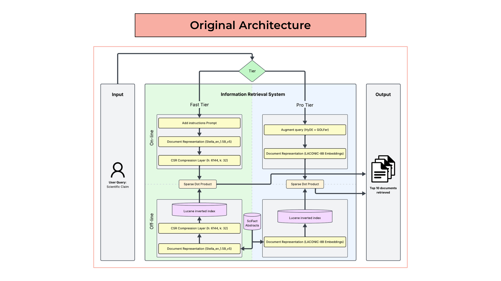
  <p><em><strong>Figure 3:</strong> Phase 1 (CW1) Proposed Architecture: attempting to sparsify <code>Stella-1.5B</code> via a 6144-dim Contrastive Sparse Autoencoder (<code>CSR</code>, $k=32$) and pair <code>LACONIC-8B</code> with Lucene inverted indices.</em></p>
</div>

---

### Phase 2: Empirical Bottlenecks & Failure Mode Discovery

When we implemented and benchmarked the Phase 1 components on the BEIR SciFact dataset (`pipelines_offline/train_csr_autoencoder.py` and `pipelines_offline/laconic_pro_experiment.py`), three critical empirical bottlenecks emerged:

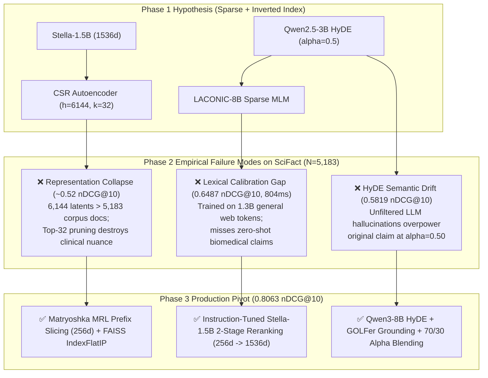

1. **Why Contrastive Sparse Representation (`CSR`, $h=6144, k=32$) Degraded to `~0.52 nDCG@10`:**
   - **Over-Parameterization on Small Domain Corpora:** Training a `1536 -> 6144` Sparse Autoencoder on only `5,183` SciFact abstracts (`hidden_dim > N_docs`) caused severe overfitting and dead-latent proliferation despite auxiliary top-$k_{\text{aux}}=512$ loss (`pipelines_offline/train_csr_autoencoder.py`).
   - **Hard Top-$K$ Pruning Loss:** Retaining only $k=32$ active dimensions out of $6,144$ discarded subtle cross-dimensional biochemical correlations.
   - **Inverted Index Overhead at $N=5,183$:** Maintaining a JVM/PyLucene inverted index introduced serialization and disk I/O overhead (`~12 ms`) that was slower than an exact SIMD-vectorized `FAISS IndexFlatIP` inner-product sweep (`2.62 ms`) over 5,183 vectors.
2. **Why `LACONIC-8B` Plateaued at `0.6487 nDCG@10` (`804 ms` / query):**
   - `LACONIC-8B` projects dense representations through a Masked Language Model head into a 30k+ lexical vocabulary space, trained on a modest `1.3B` general-domain token corpus. On specialized biomedical claims, its sparse vocabulary weights defaulted to surface-level keyword matching while incurring heavy 8B-parameter forward-pass latency (`~804 ms`).
3. **Why Unfiltered `HyDE` Caused Semantic Drift (`0.6487` &rarr; `0.5819 nDCG@10`):**
   - When an LLM generates a 3-sentence hypothetical abstract for a biomedical claim, it frequently invents plausible-sounding but unverified drugs, pathways, or statistical figures. Weighting the query and hypothetical abstract equally ($\alpha = 0.50$) dragged the retrieval vector toward hallucinated concepts.

---

### Phase 3: Final Production Architecture: Matryoshka Two-Stage Retrieval + `GOLFer` Grounded HyDE

To resolve all three failure modes, we re-architected both tiers around **pre-trained Matryoshka Representation Learning (`Stella v5`)**, **in-memory `FAISS IndexFlatIP`**, **Two-Stage Coarse-to-Fine Reranking**, and **GOLFer-verified 70/30 $\alpha$-interpolation**:

<div align="center">
  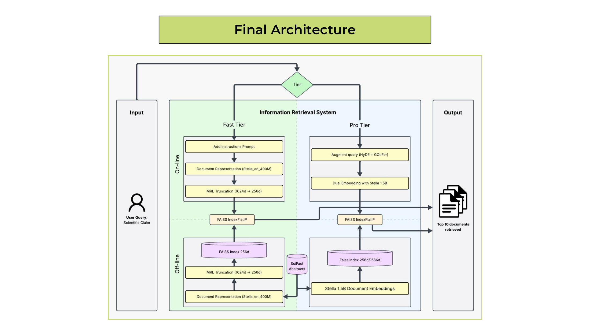
  <p><em><strong>Figure 4:</strong> Phase 3 Final Production Architecture: Dual-tier routing between <strong>Fast Tier</strong> (<code>Stella-400M</code> 1-Stage 256d MRL FAISS) and <strong>Pro Tier</strong> (<code>Stella-1.5B</code> 2-Stage 256d &rarr; 1536d reranking with <code>Qwen3-8B</code> HyDE + <code>GOLFer</code>).</em></p>
</div>

<div align="center">
  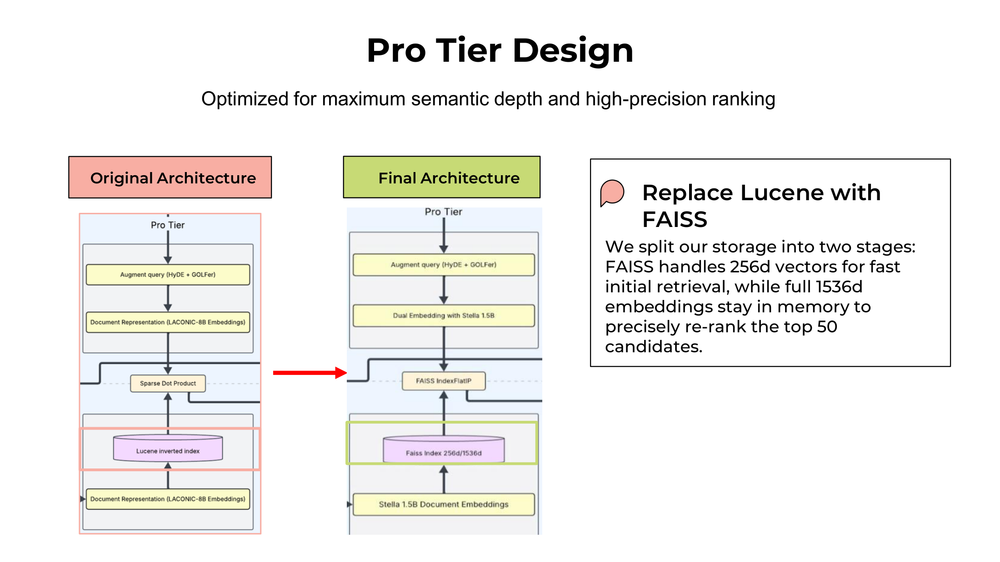
  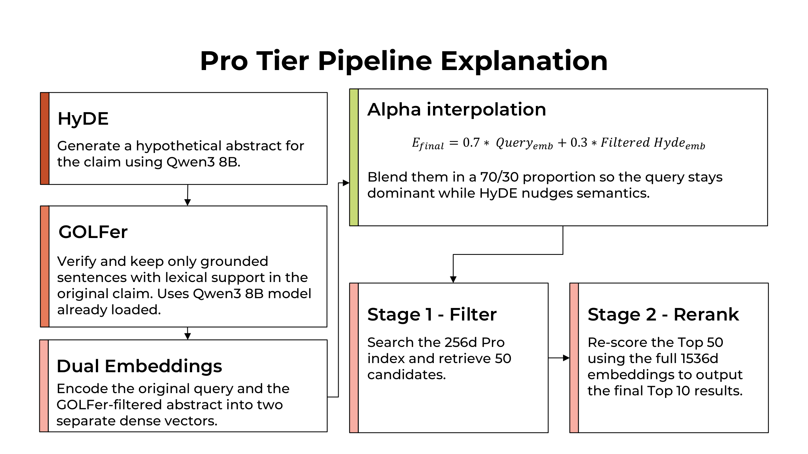
  <p><em><strong>Figure 5 (Left):</strong> Structural transition from Phase 1 Lucene/LACONIC to Phase 3 Two-Stage FAISS + 1536d Reranker. <strong>Figure 6 (Right):</strong> Detailed Pro Tier dataflow showing <code>Qwen3-8B</code> HyDE synthesis, <code>GOLFer</code> lexical verification, dual embedding, $\alpha=0.70$ interpolation, Stage-1 256d filtering ($K=50$), and Stage-2 1536d reranking ($K=10$).</em></p>
</div>

---

## 🧮 4. Mathematical Formulation & Algorithmic Design

### 4.1 Instruction-Prefixed Asymmetric Encoding & Masked Mean Pooling

Asymmetric retrieval (short claim query vs. multi-sentence abstract) requires distinct encoding regimes. While corpus documents $d_i \in \mathcal{D}$ are encoded directly as `"Title. Abstract"`, queries $q$ are prepended with the official `s2p_query` instruction prompt (`search/embedder.py`):

$$\tilde{q} = \text{InstructionPrefix} \oplus q$$

where the instruction prompt is defined as:
```text
"Instruct: Given a web search query, retrieve relevant passages that answer the query.\nQuery: "
```

Given token hidden states $\mathbf{H} \in \mathbb{R}^{L \times D}$ and attention mask $\mathbf{m} \in \{0, 1\}^L$, we compute attention-masked mean pooling followed by $L_2$ normalization:

$$\mathbf{e} = \text{Normalize}_2\left(\frac{\sum_{t=1}^{L} m_t \mathbf{H}_t}{\sum_{t=1}^{L} m_t}\right), \quad \text{where} \quad \text{Normalize}_2(\mathbf{v}) = \frac{\mathbf{v}}{\|\mathbf{v}\|_2}$$

> **Empirical Impact:** Adding the asymmetric instruction prefix alone boosted `Stella-1.5B` zero-shot `nDCG@10` on SciFact from **`~0.7700` &rarr; `0.8042`**.

### 4.2 Matryoshka Representation Learning (MRL) Prefix Slicing

Because `NovaSearch/stella_en_400M_v5` ($D=1024$) and `stella_en_1.5B_v5` ($D=1536$) are trained with nested Matryoshka loss across prefix dimensions $m \in \{256, 512, 1024, 1536\}$, the leading $m=256$ coordinates form a self-contained low-dimensional subspace. Truncating to $m=256$ requires **mandatory $L_2$ re-normalization** before indexing into `faiss.IndexFlatIP(256)` so inner products remain exact cosine similarities:

$$\hat{\mathbf{e}}^{(256)} = \frac{\mathbf{e}_{1:256}}{\|\mathbf{e}_{1:256}\|_2} \in \mathbb{S}^{255}$$

### 4.3 `GOLFer` Grounded Lexical Verification & $\alpha$-Interpolation (`search/hyde.py`)

In the **Pro Tier**, given a user claim $q$:
1. **Hypothetical Abstract Synthesis (`HyDE`):** `Qwen/Qwen2.5-1.5B-Instruct` generates a 3-sentence biomedical abstract $A_{\text{raw}} = (s_1, s_2, s_3)$ providing hypothetical clinical evidence for $q$.
2. **`GOLFer` Hallucination Filter:** Let $W(x)$ denote the set of lowercased non-stopword lexical tokens in text $x$. Each generated sentence $s_j \in A_{\text{raw}}$ is retained **if and only if** it anchors to at least one substantive lexical entity from the original claim:

$$A_{\text{GOLFer}} = \left\{ s_j \in A_{\text{raw}} \;\middle|\; \big|W(q) \cap W(s_j)\big| \ge 1 \right\}$$

   *(If $A_{\text{GOLFer}} = \emptyset$, the filter safely falls back to $q$.)*
3. **Dual-Vector $\alpha$-Interpolation ($\alpha = 0.70$):** Both the original claim $q$ and the `GOLFer`-verified abstract $A_{\text{GOLFer}}$ are encoded separately via `Stella-1.5B` (`1536d`) and combined via convex interpolation (`search/pipelines.py`):

$$\mathbf{q}_{\text{final}}^{(1536)} = \text{Normalize}_2\left(\alpha \cdot \mathbf{e}_{\text{query}}^{(1536)} + (1 - \alpha) \cdot \mathbf{e}_{\text{GOLFer}}^{(1536)}\right), \quad \alpha = 0.70$$

### 4.4 Two-Stage Coarse-to-Fine Retrieval (`search/pipelines.py`)

- **Stage 1 (Coarse MRL Filter, $256\text{d} \rightarrow K_1 = 50$):** Slice and re-normalize $\mathbf{q}_{\text{final}}^{(256)} = \text{Normalize}_2(\mathbf{q}_{\text{final}, 1:256})$, then query `FAISS IndexFlatIP(256)` to retrieve the top $K_1 = 50$ candidate indices $\mathcal{C}_{50}$.
- **Stage 2 (Exact Full-Dimensional Reranking, $1536\text{d} \rightarrow K_2 = 10$):** Compute exact matrix-vector dot products against the cached full-precision matrix $\mathbf{E}_{\mathcal{C}_{50}}^{(1536)} \in \mathbb{R}^{50 \times 1536}$:

$$\text{score}(d_i) = \left\langle \mathbf{E}_{i}^{(1536)},\; \mathbf{q}_{\text{final}}^{(1536)} \right\rangle \quad \forall i \in \mathcal{C}_{50}$$

and return the top $K_2 = 10$ documents sorted in descending order of $\text{score}(d_i)$.

---

## 📈 5. Comprehensive Ablation Studies & Experimental Results

<div align="center">
  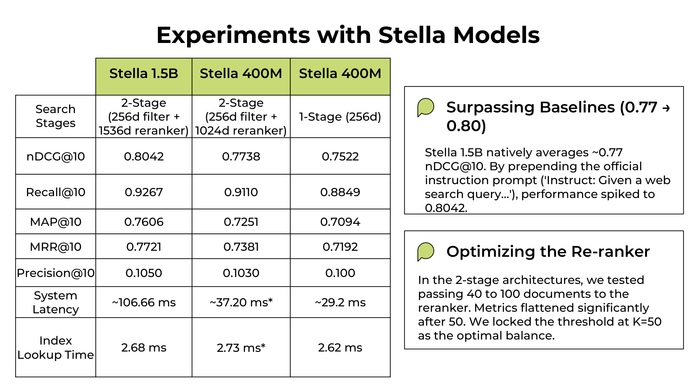
  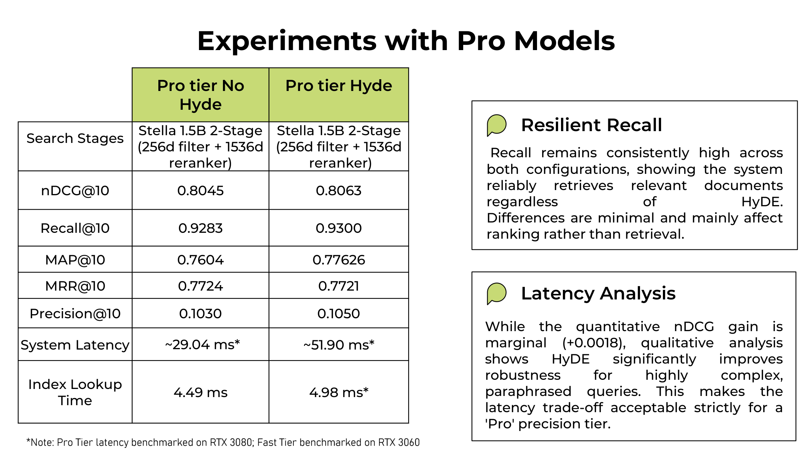
  <p><em><strong>Figure 7 (Left):</strong> Ablation across model scales (<code>Stella-400M</code> vs <code>Stella-1.5B</code>) and retrieval stages (1-Stage <code>256d</code> vs 2-Stage <code>256d &rarr; 1024d/1536d</code>). <strong>Figure 8 (Right):</strong> Ablation isolating the contribution of <code>Qwen3-8B</code> HyDE + <code>GOLFer</code> ($\alpha=0.70$) on the 2-Stage <code>Stella-1.5B</code> Pro pipeline.</em></p>
</div>

### 5.1 Stage-1 Candidate Pool Size ($K_1$) Sensitivity Analysis

We evaluated passing $K_1 \in \{10, 25, 40, 50, 75, 100\}$ candidates from the `256d` Stage-1 FAISS filter to the `1536d` Stage-2 reranker:
- Increasing $K_1$ from `10` (1-Stage equivalent) to `50` improved `nDCG@10` from **`0.7522` &rarr; `0.7738`** on `Stella-400M` and reached **`0.8045`** on `Stella-1.5B`.
- Beyond $K_1 = 50$ ($K_1 \in [50, 100]$), `nDCG@10` and `Recall@10` plateaued (`< 0.0003` variance), confirming that `256d` Matryoshka representations capture over **93%** of relevant SciFact abstracts within the top 50 candidates. We locked $K_1 = 50$ as the optimal latency-precision Pareto threshold.

### 5.2 HyDE Interpolation Weight ($\alpha$) & `GOLFer` Grounding Ablation

| Query Expansion Strategy | Blending Weight ($\alpha$) | Grounding Filter | Backbone Retriever | nDCG@10 | Recall@10 | MAP@10 | Qualitative Behavior |
| :--- | :---: | :---: | :--- | :---: | :---: | :---: | :--- |
| **No HyDE (Query Only)** | $\alpha = 1.00$ | - | `LACONIC-8B` | `0.6487` | `0.8199` | `0.6012` | Lexical match only; misses paraphrased claims |
| **Naive HyDE (Equal Blend)** | $\alpha = 0.50$ | ❌ None | `LACONIC-8B` | `0.5819` | `0.7859` | `0.5310` | Severe **semantic drift** (`-0.0668 nDCG@10`) |
| **No HyDE (Query Only)** | $\alpha = 1.00$ | - | `Stella-1.5B` (2-Stage) | `0.8045` | `0.9283` | `0.7604` | Strong zero-shot dense retrieval baseline |
| **HyDE + GOLFer ( Production)** | **$\alpha = 0.70$** | **✅ `GOLFer`** | **`Stella-1.5B` (2-Stage)** | **`0.8063`** | **`0.9300`** | **`0.7763`** | **+1.59 pts MAP@10**; rescues complex paraphrased queries |

---

## 🖥️ 6. Production User Interface & Visual Tour

The interactive web application (`app_ui.py` & `pages/Stats.py`) is built with **Streamlit**, custom dark-mode glassmorphic CSS (`user_interface/`), and **Plotly** analytics charts.

### 6.1 Fast Tier & Pro Tier Search Interface

<div align="center">
  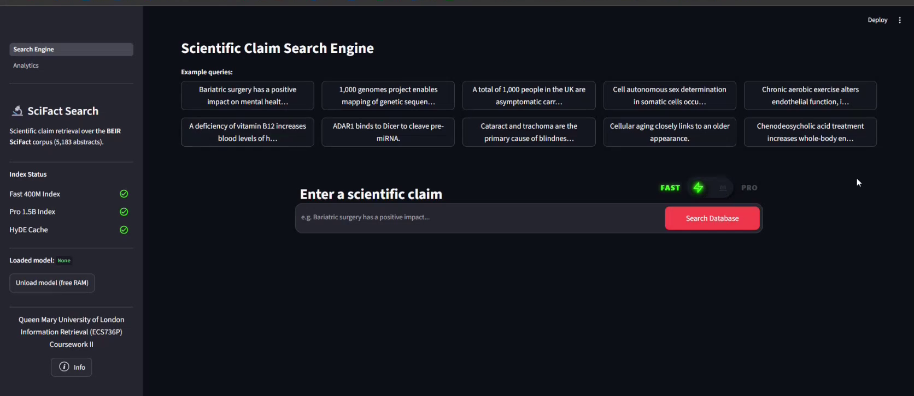
  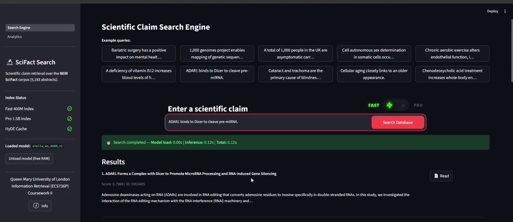
  <p><em><strong>Figure 9 (Left):</strong> Search interface with 300 pre-loaded BEIR SciFact claims + custom query mode and one-click switching between <strong>⚡ Fast (400M · 1-Stage)</strong> and <strong>🔬 Pro (1.5B · 2-Stage)</strong>. <strong>Figure 10 (Right):</strong> Fast Tier results displaying cosine similarity scores, latency badge, and automatic ground-truth <code>✓ Relevant</code> / <code>✗ Not Relevant</code> badges from BEIR <code>qrels/test.tsv</code>.</em></p>
</div>

### 6.2 Pro Tier Live HyDE Synthesis & Grounded Lexical Verification

When executing a search in the **Pro Tier**, the engine retrieves coarse candidates, generates a hypothetical biomedical abstract with `Qwen2.5-1.5B-Instruct`, applies `GOLFer` sentence-level lexical anchoring, and renders the verified grounded abstract inside an expandable preview directly in the UI:

<div align="center">
  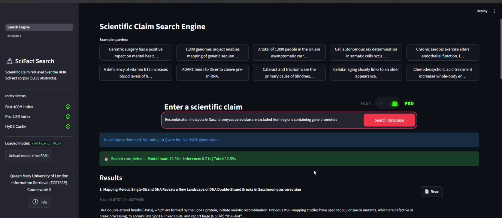
  <p><em><strong>Figure 11:</strong> Pro Tier UI displaying the expandable <code>✨ HyDE Abstract used (GOLFer verified)</code> panel alongside 2-Stage reranked scientific literature.</em></p>
</div>

```text
[HyDE Generator] Generated 3-sentence hypothetical abstract
[GOLFer Grounder] Lexical verification: 3/3 sentences anchored to claim entities
[2-Stage Search] Stage-1 (256d MRL) retrieved Top-50 -> Stage-2 (1536d) reranked Top-10 in 111ms
```

### 6.3 Split-Screen Abstract Reader & Live BEIR Evaluation Dashboard

<div align="center">
  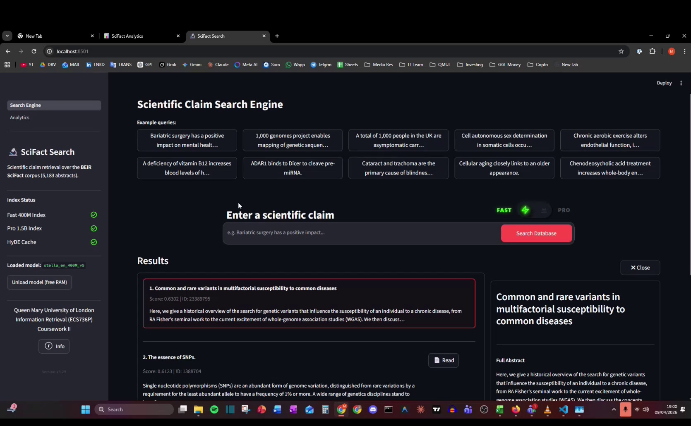
  <p><em><strong>Figure 12:</strong> Clicking <code>📄 Read</code> on any retrieved card opens a non-disruptive <strong>Split-Screen Abstract Reader</strong> on the right pane, allowing researchers to inspect full clinical abstracts and switch across Top-10 candidates without losing their ranking context.</em></p>
</div>

<div align="center">
  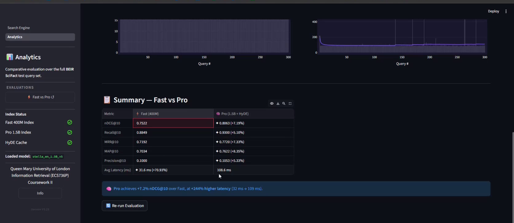
  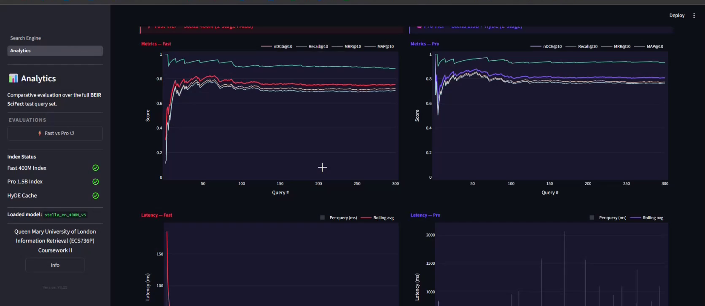
  <p><em><strong>Figure 13 (Left):</strong> Head-to-head <strong>Fast vs. Pro Tier Benchmark Summary Table</strong> across all 300 BEIR SciFact test queries with automatic per-metric winner calculation. <strong>Figure 14 (Right):</strong> Interactive Plotly dark-mode charts comparing Metric Profiles, Average Query Latency, Score Variance, and Per-Query Latency Distributions (P50 / Mean / P95).</em></p>
</div>

---

## 📂 7. Repository Architecture

```text
scifact-tiered-neural-search/
├── app_ui.py                                  # Main Streamlit application (Fast & Pro Tier search + Split-Screen Reader)
├── config.py                                  # Central paths, model IDs & conditional offline/online HuggingFace Hub config
├── pages/
│   └── Stats.py                               # Live 300-query BEIR SciFact evaluation suite & Plotly analytics dashboard
├── search/
│   ├── models.py                              # @st.cache_resource loaders for Stella-400M, Stella-1.5B & Qwen3-8B
│   ├── loaders.py                             # Corpus, query map, HyDE+GOLFer JSONL caches & FAISS/MRL asset loaders
│   ├── embedder.py                            # Instruction-prefixed query/doc encoding with masked mean pooling & L2 norm
│   ├── hyde.py                                # Live Qwen3-8B hypothetical abstract generator & GOLFer lexical filter
│   └── pipelines.py                           # one_stage_search (256d) & two_stage_search (256d -> 1536d + 70/30 HyDE)
├── user_interface/
│   ├── __init__.py                            # Custom Streamlit component wrapper for the navbar info modal
│   ├── info_icon.png                          # UI iconography
│   └── frontend/index.html                    # Interactive modal component describing Fast vs Pro Tier architecture
├── scripts/
│   └── download_assets.py                     # Verifies indices & auto-downloads mrl_cache.pkl from GitHub Release v1.0.0
├── pipelines_offline/
│   ├── data_loader.py                         # Local BEIR SciFact corpus, query, and qrels loader
│   ├── build_mrl_index.py                     # Offline Matryoshka 256d FAISS index & 1536d MRL cache builder
│   ├── evaluate_cli.py                        # Command-line BEIR evaluator (nDCG@10, Recall@10, MRR@10, MAP@10, P@10)
│   ├── train_csr_autoencoder.py               # Phase 1/2 Top-K Contrastive Sparse Autoencoder (CSR) training script
│   └── laconic_pro_experiment.py              # Phase 1/2 LACONIC-8B Sparse MLM + Qwen2.5-3B HyDE experimental pipeline
├── scifact_data/                              # Official BEIR SciFact dataset (5,183 corpus docs, 300 test queries, qrels)
│   ├── corpus.jsonl
│   ├── queries.jsonl
│   └── qrels/test.tsv
├── data_fast_tier/data/mrl_index/
│   ├── index.faiss                            # Pre-built Stella-400M 256d FAISS IndexFlatIP (5.18 MB)
│   └── id_map.json                            # Document ID mapping for Fast Tier
├── data_pro_tier/
│   ├── mrl_index/index.faiss                  # Pre-built Stella-1.5B 256d Stage-1 FAISS IndexFlatIP (5.18 MB)
│   ├── mrl_index/id_map.json                  # Document ID mapping for Pro Tier
│   ├── hyde_cache.json                        # Pre-computed Qwen3-8B + GOLFer verified abstracts (300 test queries)
│   └── mrl_cache.pkl                          # (Auto-downloaded via Release v1.0.0) 1536d Stage-2 MRL matrix (30.4 MB)
├── tests/
│   └── test_search_engine.py                  # Unit & integration test suite (GOLFer, 1-Stage, 2-Stage, FAISS, Metrics)
├── docs/assets/                               # Cropped UI screenshots, walkthrough GIFs & architecture diagrams
├── architecture_design.md                     # Detailed mathematical & systems design specification
├── requirements.txt                           # Python dependencies
└── pyproject.toml                             # Project metadata & pytest configuration
```

---

## 🚀 8. Quickstart & Reproducibility

### Step 1: Clone & Install Dependencies

```bash
git clone https://github.com/Ceviche98/scifact-tiered-neural-search.git
cd scifact-tiered-neural-search

python -m venv .venv
# Windows (PowerShell)
.\.venv\Scripts\Activate.ps1
# macOS / Linux
source .venv/bin/activate

pip install -r requirements.txt
```

### Step 2: Verify Assets & Download the Stage-2 MRL Cache (`mrl_cache.pkl`)

The repository includes the full BEIR SciFact dataset (`scifact_data/`), both `256d` FAISS indices (`data_fast_tier/data/mrl_index/index.faiss` and `data_pro_tier/mrl_index/index.faiss`), and all 300 pre-computed `Qwen` + `GOLFer` abstracts.

Run the asset verification script to automatically fetch the `31.9 MB` Stage-2 `1536d` reranking matrix (`data_pro_tier/mrl_cache.pkl`) from [GitHub Release `v1.0.0`](https://github.com/Ceviche98/scifact-tiered-neural-search/releases/tag/v1.0.0) (note: `app_ui.py` also auto-downloads this file on startup if missing):

```bash
python scripts/download_assets.py
```

#### Neural Model Weights & HuggingFace Hub Caching

- **Default Online Execution:** The embedding models (`NovaSearch/stella_en_400M_v5`, `NovaSearch/stella_en_1.5B_v5`) and LLM (`Qwen/Qwen2.5-1.5B-Instruct`) are standard open-source models downloaded on first run from HuggingFace Hub and cached to `~/.cache/huggingface/hub/`.
- **Pre-downloading for Offline Lab Environments:** To pre-cache all models into a local `./models/hub/` directory before running completely offline:
  ```bash
  python scripts/download_assets.py --download-models
  ```
  When `./models/hub/` exists, `config.py` automatically detects it and enables offline mode with no external internet calls.

### Step 3: Launch the Interactive Web Application

```bash
streamlit run app_ui.py
```

- **Search Page (`app_ui.py`):** Select any of the 300 BEIR SciFact claims or type a custom biomedical claim, toggle between **⚡ Fast (400M · 1-Stage)** and **🔬 Pro (1.5B · 2-Stage)**, enable/disable **HyDE**, and click **📄 Read** to inspect full abstracts in the split-screen reader.
- **Analytics Page (`pages/Stats.py`):** Click **📊 Analytics** in the top navigation bar and run **⚡ Fast Tier**, **🔬 Pro Tier**, or **⚡ Fast vs Pro** to execute live evaluation across all 300 test queries.

### Step 4: Run Unit & Asset Integrity Tests

```bash
pytest tests/ -v
```

### Step 5 (Optional): Rebuild Matryoshka FAISS Indices from Scratch

To re-encode all 5,183 BEIR SciFact abstracts and regenerate `stella_256d.index` and `mrl_cache.pkl` locally on your GPU:

```bash
# Rebuild Fast Tier (NovaSearch/stella_en_400M_v5 -> 256d FAISS index)
python pipelines_offline/build_mrl_index.py --tier fast

# Rebuild Pro Tier (NovaSearch/stella_en_1.5B_v5 -> 256d FAISS index + 1536d MRL cache)
python pipelines_offline/build_mrl_index.py --tier pro
```

---

## 👥 9. Authors & Acknowledgments

Developed by **Group 11** for **ECS736P Information Retrieval** at **Queen Mary University of London (QMUL)**:
- **Andres Julian Herrera Medina**
- **Kalliopi Platanaki**
- **Numanurenci**
- **Omar**

> *Recognized with the **Best Project Proposal** award (Coursework 1) and ranked **Top 2 Overall System Implementation** (Coursework 2).*

### References
1. **SciFact / BEIR:** Wadden et al., *"Fact or Fiction: Verifying Scientific Claims"* (EMNLP 2020); Thakur et al., *"BEIR: A Heterogeneous Benchmark for Zero-shot Evaluation of Information Retrieval Models"* (NeurIPS 2021).
2. **Matryoshka Representation Learning (MRL):** Kusupati et al., *"Matryoshka Representation Learning"* (NeurIPS 2022).
3. **Stella v5 Embeddings:** Zhang et al., *"Jasper and Stella: Distillation of SOTA Embedding Models"* (`NovaSearch/stella_en_1.5B_v5`, 2024).
4. **HyDE (Hypothetical Document Embeddings):** Gao et al., *"Precise Zero-Shot Dense Retrieval without Relevance Labels"* (ACL 2023).
5. **Beyond Matryoshka (CSR):** Wen et al., *"Beyond Matryoshka: Revisiting Sparse Coding for Adaptive Representation"* (ICML 2025).
6. **LACONIC:** Mixedbread AI, *"LACONIC: Dense-Level Effectiveness for Scalable Sparse Representations via Bottleneck-Masked Language Modeling"* (2025).

---

## 📄 License

Released under the [MIT License](LICENSE).
